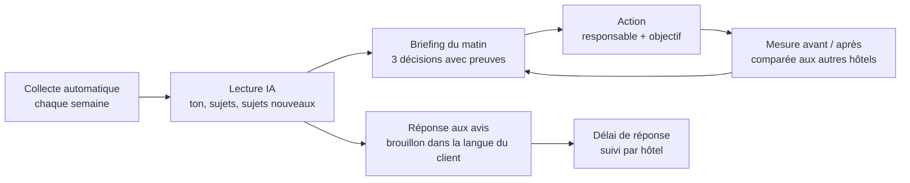

# VoxCX 2.0 : plan d'amélioration majeur

Rédigé le 14/11/2026, après la remarque de l'encadrante (« l'application ne sert à rien »).
Maquette interactive : `docs/maquettes_v3/VoxCX_2.0.html` (lien privé : https://claude.ai/artifact/NQamHBQWKeQtHWMFhB4nvX).

## 1. Pourquoi la version 1 « ne sert à rien »

La remarque est juste sur le fond. La version 1 **décrit** les avis, mais elle ne **fait rien faire** à personne.

| Problème de la v1 | Conséquence pour un directeur d'hôtel |
|---|---|
| C'est un tableau de bord : des chiffres et des graphiques à interpréter soi-même | Il faut un analyste pour comprendre quoi faire. Un directeur ne l'ouvrira pas deux fois. |
| 81 % des avis ont 5 étoiles, et la page d'accueil montre surtout la moyenne (4,62) | Le message reçu est « tout va bien », alors que des problèmes graves existent (lit bébé sans barreaux, cafards, discrimination). |
| Le module prédictif devine si un avis est mécontent **à partir de son texte**, alors que la note du client est déjà connue | Il prédit une information qu'on a déjà. Le jury peut le démonter en une question. |
| Liste fixe de 11 sujets avec des mots-clés | Les sujets nouveaux sont invisibles. Exemple réel : deux clients se plaignent d'avoir été moins bien traités à cause de leur origine. Ce n'est dans aucune case. Il y a aussi des erreurs de classement : une phrase sur des viennoiseries sèches est rangée dans « Bruit ». |
| Le plan d'actions est une liste sans suite | Personne ne vérifie si une action a vraiment amélioré les avis. |
| Une seule collecte, faite à la main le 16/10/2026 | Les données vieillissent dès le lendemain. |
| Pas d'utilisateur réel : aucun rôle, aucune alerte, aucun test chronométré, aucun questionnaire SUS | Aucune preuve que l'outil fait gagner du temps. |

**Ce que la v1 a de bon et qu'on garde** : la collecte réelle (3 879 avis, 7 hôtels, 7 langues), la lecture du ton en local, la carte des plaintes par sujet et par hôtel, le rapport honnête (aucun chiffre inventé).

## 2. L'idée de la version 2.0 en une phrase

**VoxCX passe de « tableau de bord des avis » à « assistant de décision du directeur ».** Chaque matin il dit quoi faire, il aide à répondre aux clients et il prouve si les actions ont marché.

## 3. Les 8 améliorations, par ordre de priorité

### P1. Briefing « Ce matin » (écran 1 de la maquette)
- Au lieu de 6 indicateurs, l'accueil montre **les 3 décisions à prendre**, chacune avec ses preuves : chiffres, citations de clients, hôtel concerné, responsable proposé.
- Règles de tri : gravité (sécurité, hygiène, discrimination en tête), volume, tendance sur 4 semaines, hôtel le plus touché.
- Le « pouls » du groupe (note par semaine et mécontents par semaine) montre le sujet n°1 et une citation réelle pour chaque semaine.
- **Constat réel trouvé grâce à cette vue** : depuis début août, « Chambre et literie » est le premier sujet de plainte presque chaque semaine, et la note du groupe tombe à 4,37 la semaine du 03/08.
- Effort : 3 jours. Réutilise les calculs de priorisation déjà codés.

### P2. Réponse aux avis assistée (écran 3)
- File des avis négatifs. Pour chacun : texte original, traduction, sujets détectés, et un **brouillon de réponse dans la langue du client**, au ton formel ou chaleureux.
- La réponse est **toujours relue par un humain** avant publication (validation humaine, à présenter comme un choix éthique).
- Indicateur clé : **délai de réponse par hôtel**. Constat réel : le Club Agdal Medina répond en 172 h (délai médian), le Solazur en 3 h.
- Pourquoi c'est fort pour la soutenance : le gain se mesure (temps pour rédiger une réponse avec et sans l'outil) et parle à n'importe quel hôtelier.
- Effort : 3 jours. Mode en ligne : Claude (clé côté serveur uniquement, jamais dans le navigateur). Mode local : réponses types par sujet et par langue.

### P3. Détection des sujets nouveaux (remplace la liste fixe)
- Regrouper automatiquement les phrases négatives par sens (vecteurs MiniLM, **déjà installé**), puis donner un nom à chaque groupe (IA ou nommage manuel).
- Un groupe qui n'existait pas les semaines d'avant devient une alerte « Nouveau sujet ». Exemple réel : traitement inégal selon l'origine (2 avis, Rose Garden et Europa).
- Permettre de corriger un classement d'un clic. Les corrections servent à mesurer et améliorer la précision.
- Effort : 4 jours. Aucune installation nouvelle (scikit-learn et sentence-transformers sont déjà là).

### P4. Boucle d'action fermée (écran 4)
- Chaque action a : un responsable, un hôtel, un sujet, un objectif chiffré, une date de début.
- Une fois l'action terminée, VoxCX compare automatiquement les avis sur ce sujet **30 jours avant et 30 jours après**, et les compare aux autres hôtels sur la même période. C'est la méthode des « doubles différences », qui est bien plus solide que le simple avant / après de la v1.
- Effort : 3 jours.

### P5. Un prédictif qui sert vraiment
- Supprimer (ou mettre en annexe) la prédiction « avis mécontent d'après son texte ».
- Le remplacer par **« quels hôtels risquent de baisser dans les 4 prochaines semaines ? »** : prévision de la note hebdomadaire par hôtel à partir des semaines passées, de la part de plaintes et des sujets qui montent. On lance une alerte si la baisse prévue dépasse un seuil.
- Valider honnêtement : entraînement sur mai à août, test sur septembre et octobre. Seuil choisi sans regarder le jeu de test (corrige le biais signalé dans la v1).
- Effort : 3 jours.

### P6. Collecte automatique et plusieurs sources
- Collecte hebdomadaire planifiée avec l'outil existant (`gmaps_reviews.py`). Coût réel observé : environ 0,60 $ pour 1 000 avis.
- Plus tard : TripAdvisor et Booking, pour ne plus dépendre d'une seule plateforme (limite citée dans le rapport).
- Effort : 2 jours. Toute dépense passe par l'accord du porteur du projet.

### P7. Comparaison avec la concurrence
- Collecter 2 ou 3 hôtels concurrents par ville (même catégorie) pour situer chaque Kenzi : « Rose Garden est 0,4 point sous ses voisins sur la propreté ».
- Effort : 2 jours plus le coût de collecte (quelques dollars).

### P8. Rôles et alertes
- Deux rôles : directeur d'hôtel (voit son hôtel) et siège (voit les 7). Connexion obligatoire.
- Résumé hebdomadaire envoyé automatiquement (e-mail) avec les 3 décisions.
- Effort : 3 jours. Appliquer la grille de sécurité (verou) : comptes, accès par hôtel, aucune clé dans le navigateur.

## 4. Planning proposé

| Étape | Contenu | Durée |
|---|---|---|
| 1 | Nouveau design (maquette v3 validée) + P1 briefing + P2 réponses | 1 semaine |
| 2 | P3 sujets nouveaux + P4 boucle d'action | 1 semaine |
| 3 | P5 prédictif utile + P6 collecte automatique | 1 semaine |
| 4 | Test avec 3 à 5 utilisateurs (chronométrage + questionnaire SUS), mise à jour du rapport et du PowerPoint | 3 à 4 jours |
| Option | P7 concurrence, P8 rôles et alertes | 1 semaine |

Si le temps manque avant la soutenance : faire **P1 + P2 + P3 + le test utilisateurs**. Avec ces quatre-là, l'outil est utile, mesurable et défendable.

## 5. Comment le présenter à l'encadrante

- Reconnaître la limite : « la v1 décrivait, la v2 fait agir ».
- Montrer les 3 constats réels que la v1 cachait : chambres en baisse depuis août, 172 h de délai à Agdal Medina, sujet nouveau sur l'égalité de traitement.
- Mesurer un gain concret : temps pour traiter 10 avis négatifs avec et sans VoxCX.
- Garder la ligne honnête du rapport : les brouillons de réponse et les « après » de la maquette sont des exemples, pas des résultats.

## 6. Ce qui ne change pas
- Python + Starlette + interface HTML maison, lancement en local avec `lancer_app.bat`.
- Mode local gratuit par défaut ; mode en ligne seulement avec une clé côté serveur.
- Aucune installation sans accord de Saad.
